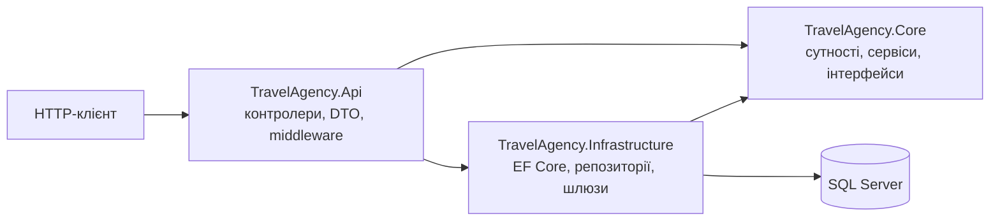
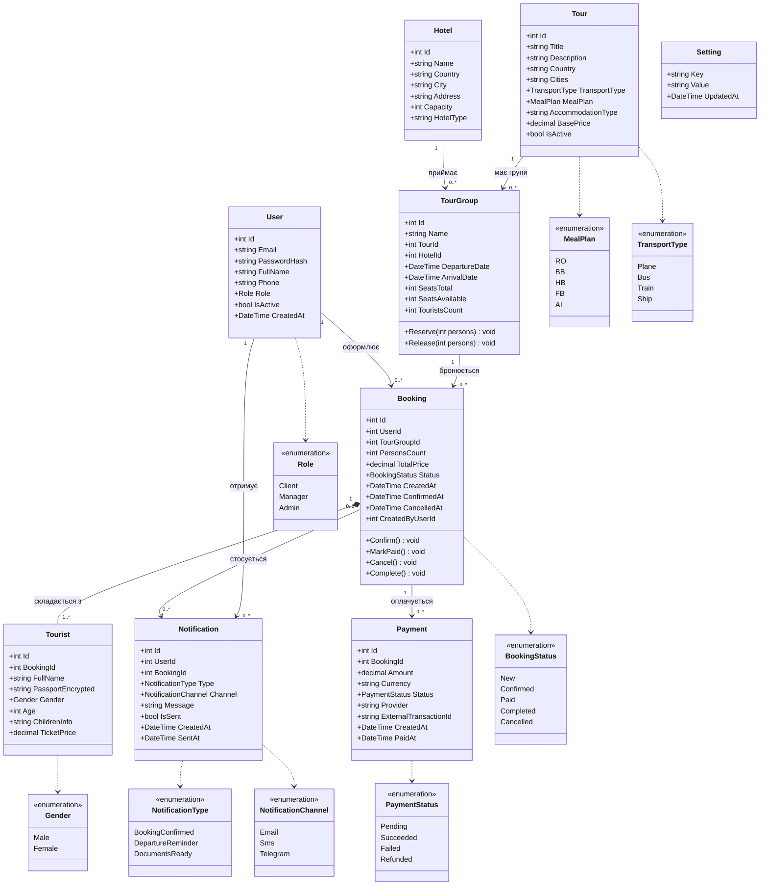
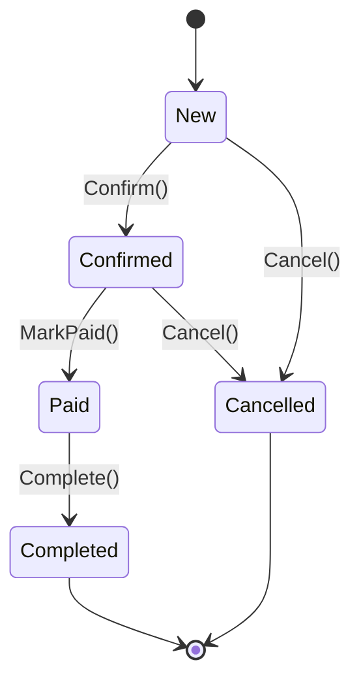
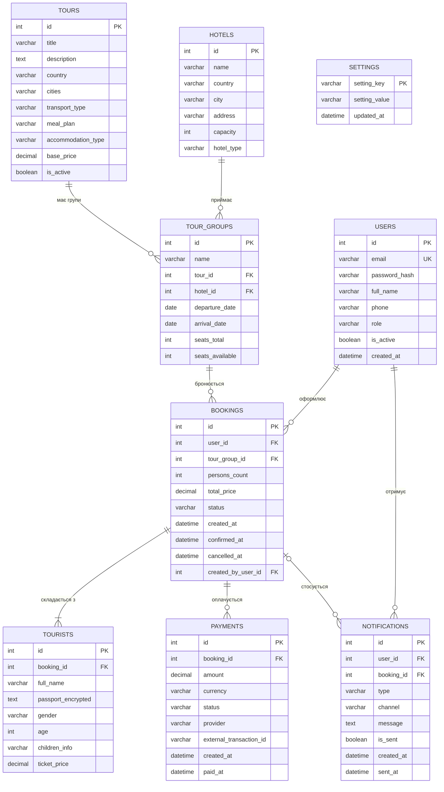

# 02. Проєктування моделей реалізації

Друга частина ЛР3. На основі аналізу вимог (`01-requirements-analysis.md`) та моделі бази даних
предметної області «Туристична фірма» подано: діаграми класів зі зв'язками, опис атрибутів і методів,
ER-діаграму бази даних SQL Server, діаграму станів бронювання та специфікацію REST API.

Діаграми записані мовою Mermaid і відображаються безпосередньо на GitHub.

## 1. Узгодження з моделлю бази даних

Попередньо була спроєктована БД із шести сутностей (Tourists, Tours, Tour_Groups, Group_Members, Hotels,
Sales_Report). Вимоги ЛР1–2 (авторизація, ролі, бронювання, оплата, сповіщення) потребують додаткових
сутностей, тому модель розширено; усі атрибути з даталогічної моделі збережено.

| Сутність БД | Клас у проєкті | Коментар |
|---|---|---|
| Tourists (ПІБ, паспорт, стать, вік, діти) | `Tourist` | Мандрівник у складі бронювання. `PIB → FullName`, `Passport → PassportEncrypted`, `Gender`, `Age`, `Children → ChildrenInfo` |
| Tours (назва, країна, міста, тип пересування, харчування, ціна, проживання) | `Tour` | Усі атрибути збережено: `Tour_Name → Title`, `Cities`, `Transport_Type → TransportType`, `Meal_Type → MealPlan`, `Tour_Price → BasePrice`, `Accommodation_Type → AccommodationType` |
| Tour_Groups (назва, тур, дати, кількість туристів) | `TourGroup` | Виліт за маршрутом: `Departure_Date → DepartureDate`, `Arrival_Date → ArrivalDate`. `Tourists_Count` обчислюється як `SeatsTotal − SeatsAvailable`. Додано `HotelId`, `SeatsTotal`, `SeatsAvailable` |
| Group_Members (дата продажу, турист, група, ціна квитка) | `Booking` + `Tourist` | `Sale_Date → Booking.CreatedAt`, `Ticket_Price → Tourist.TicketPrice`; група та турист пов'язані через бронювання |
| Hotels (назва, країна, місто, адреса, місця, тип) | `Hotel` | Без змін: `Capacity`, `HotelType` |
| Sales_Report (дата, група, готель, загальна вартість) | `SalesReport` (DTO) | Не зберігається в БД, а обчислюється `ReportService` з бронювань і оплат (немає дублювання даних) |
| — (нові за вимогами ЛР1–2) | `User`, `Payment`, `Notification`, `Setting` | Авторизація й ролі, оплата, сповіщення, налаштування |

Відмінності, що пояснюють розбіжності з БД-моделлю:
- У БД-моделі `Passport` унікальний. У проєкті паспортні дані шифруються AES-256-GCM (шифртекст неунікальний), а одна
  людина може бути в кількох бронюваннях, тому унікальність за паспортом не накладається.
- Готель прив'язано до групи (`TourGroup.HotelId`), оскільки в різні вильоти за одним маршрутом готель може відрізнятися.
- Поле `Tour_Price` названо `BasePrice`: ціна за особу фіксується в `Tourist.TicketPrice` на момент бронювання.

## 2. Архітектура

Рішення має три проєкти та шари `Controller → Service → Repository`:

`Core` не залежить від інших проєктів: усі зовнішні залежності (БД, шифрування, платіжний шлюз,
сповіщення) подані інтерфейсами, реалізації яких лежать в `Infrastructure`.
Це спрощує тестування (у ЛР4 інтерфейси підміняються через Moq).

## 3. Діаграма класів: доменна модель

Поля `ConfirmedAt`, `CancelledAt`, `CreatedByUserId`, `PaidAt`, `BookingId` у `Notification`, `SentAt`,
`Tourist.ChildrenInfo` можуть бути порожніми (nullable у коді). `TouristsCount` — обчислювана властивість
(`SeatsTotal − SeatsAvailable`), у БД не зберігається.

### 3.1. Опис сутностей і атрибутів

**User** (обліковий запис)

| Атрибут | Тип | Обмеження | Опис |
|---|---|---|---|
| Id | int | PK, auto increment | Ідентифікатор |
| Email | string(255) | унікальний, обов'язковий | Логін |
| PasswordHash | string(100) | обов'язковий | Хеш BCrypt |
| FullName | string(200) | обов'язковий | ПІБ |
| Phone | string(30) | | Телефон |
| Role | Role | обов'язковий | Client / Manager / Admin |
| IsActive | bool | за замовчуванням true | Ознака активності |
| CreatedAt | DateTime | | Дата реєстрації |

**Tour** (тур, маршрут) — таблиця `Tours`

| Атрибут | Тип | Обмеження | Опис |
|---|---|---|---|
| Id | int | PK, auto increment | Код туру |
| Title | string(100) | обов'язковий | Назва туру |
| Description | string | | Опис |
| Country | string(50) | обов'язковий, індекс | Країна |
| Cities | string(200) | обов'язковий | Міста маршруту |
| TransportType | TransportType | обов'язковий | Тип пересування |
| MealPlan | MealPlan | обов'язковий | Тип харчування (RO, BB, HB, FB, AI) |
| AccommodationType | string(50) | обов'язковий | Тип проживання |
| BasePrice | decimal(10,2) | ≥ 0, індекс | Базова ціна за особу |
| IsActive | bool | | Чи показується в каталозі |

**Hotel** (готель) — таблиця `Hotels`

| Атрибут | Тип | Обмеження | Опис |
|---|---|---|---|
| Id | int | PK, auto increment | Код готелю |
| Name | string(100) | обов'язковий | Назва готелю |
| Country | string(50) | обов'язковий | Країна |
| City | string(50) | обов'язковий | Місто |
| Address | string(150) | обов'язковий | Адреса |
| Capacity | int | > 0 | Кількість місць |
| HotelType | string(30) | обов'язковий | Тип/категорія (зірковість) |

**TourGroup** (туристична група, виліт) — таблиця `TourGroups`

| Атрибут | Тип | Обмеження | Опис |
|---|---|---|---|
| Id | int | PK, auto increment | Код групи |
| Name | string(50) | обов'язковий | Назва групи |
| TourId | int | FK → Tour | Тур |
| HotelId | int | FK → Hotel | Готель проживання |
| DepartureDate | DateTime | обов'язковий, індекс | Дата відправлення |
| ArrivalDate | DateTime | ≥ DepartureDate | Дата прибуття |
| SeatsTotal | int | ≥ 0 | Усього місць у групі |
| SeatsAvailable | int | 0…SeatsTotal | Вільні місця |

**Booking** (бронювання, заявка) — таблиця `Bookings`

| Атрибут | Тип | Обмеження | Опис |
|---|---|---|---|
| Id | int | PK | Ідентифікатор |
| UserId | int | FK → User | Клієнт, що оформив заявку |
| TourGroupId | int | FK → TourGroup | Група |
| PersonsCount | int | ≥ 1, = кількості `Tourist` | Кількість осіб |
| TotalPrice | decimal(12,2) | | Сума квитків усіх мандрівників |
| Status | BookingStatus | | Статус заявки |
| CreatedAt | DateTime | | Дата продажу (`Sale_Date`) |
| ConfirmedAt, CancelledAt | DateTime? | | Дати змін статусу |
| CreatedByUserId | int? | FK → User | Менеджер, що створив бронювання (UC-12) |

**Tourist** (мандрівник у складі бронювання) — таблиця `Tourists`

| Атрибут | Тип | Обмеження | Опис |
|---|---|---|---|
| Id | int | PK | Код туриста |
| BookingId | int | FK → Booking | Бронювання |
| FullName | string(100) | обов'язковий | ПІБ туриста |
| PassportEncrypted | string | обов'язковий | Паспортні дані, AES-256-GCM |
| Gender | Gender | обов'язковий | Стать |
| Age | int | > 0 | Вік |
| ChildrenInfo | string(50) | | Відомості про дітей |
| TicketPrice | decimal(10,2) | ≥ 0 | Ціна квитка (`Ticket_Price`) |

**Payment** (оплата) — таблиця `Payments`

| Атрибут | Тип | Обмеження | Опис |
|---|---|---|---|
| Id | int | PK | Ідентифікатор |
| BookingId | int | FK → Booking | Бронювання |
| Amount | decimal(12,2) | > 0 | Сума |
| Currency | string(3) | | Валюта (UAH) |
| Status | PaymentStatus | | Статус платежу |
| Provider | string(50) | | Платіжний шлюз |
| ExternalTransactionId | string(100) | | Ідентифікатор у шлюзі |
| CreatedAt, PaidAt | DateTime / DateTime? | | Дати |

**Notification** (сповіщення), **Setting** (налаштування) мають поля, наведені на діаграмі.
`Setting.Key` є первинним ключем.

### 3.2. Зв'язки між сутностями

| Зв'язок | Кратність | Пояснення |
|---|---|---|
| Tour — TourGroup | 1 : 0..* | За одним маршрутом проводяться різні вильоти |
| Hotel — TourGroup | 1 : 0..* | Готель приймає різні групи |
| TourGroup — Booking | 1 : 0..* | На групу може бути багато бронювань |
| User — Booking | 1 : 0..* | Клієнт має багато бронювань |
| Booking — Tourist | 1 : 1..* (композиція) | Бронювання містить щонайменше одного мандрівника; без бронювання мандрівник не існує |
| Booking — Payment | 1 : 0..* | Можливі кілька спроб оплати |
| User — Notification | 1 : 0..* | Користувач отримує сповіщення |
| Booking — Notification | 0..1 : 0..* | Сповіщення може стосуватися бронювання |

### 3.3. Методи сутностей (інваріанти предметної області)

| Метод | Опис | Правило |
|---|---|---|
| `TourGroup.Reserve(persons)` | Зменшує `SeatsAvailable` | Помилка, якщо `persons` < 1 або більше вільних місць |
| `TourGroup.Release(persons)` | Повертає місця | Не перевищує `SeatsTotal` |
| `Booking.Confirm()` | `New → Confirmed` | Бізнес-правило 2, 4 |
| `Booking.MarkPaid()` | `Confirmed → Paid` | Бізнес-правило 5 |
| `Booking.Cancel()` | `New / Confirmed → Cancelled` | Бізнес-правило 2, 3 |
| `Booking.Complete()` | `Paid → Completed` | Після завершення туру |

Недопустимий перехід викликає `InvalidOperationException`, яку глобальний обробник перетворює на HTTP 409.

## 4. Діаграма станів бронювання

## 5. Діаграма класів: сервіси та інтерфейси (TravelAgency.Core)

```mermaid
classDiagram
    class AuthService {
        +Register(RegisterRequest request) User
        +Login(LoginRequest request) AuthResult
    }
    class TourService {
        +GetAll(int page, int pageSize) PagedResult
        +GetById(int id) Tour
        +Search(TourSearchCriteria criteria) PagedResult
        +Create(CreateTourRequest request) Tour
        +Update(int id, UpdateTourRequest request) Tour
        +Delete(int id) void
        +CreateGroup(CreateGroupRequest request) TourGroup
        +UpdateGroup(int id, UpdateGroupRequest request) TourGroup
        +DeleteGroup(int id) void
    }
    class HotelService {
        +GetAll() List~Hotel~
        +GetById(int id) Hotel
        +Create(HotelRequest request) Hotel
        +Update(int id, HotelRequest request) Hotel
        +Delete(int id) void
    }
    class BookingService {
        +Create(int userId, CreateBookingRequest request, int createdBy) Booking
        +GetMy(int userId) List~Booking~
        +Cancel(int bookingId, int actorId, Role actorRole) void
        +Confirm(int bookingId) Booking
    }
    class AvailabilityChecker {
        +IsAvailable(TourGroup group, int persons, DateTime now) bool
    }
    class PaymentService {
        +Pay(int bookingId, int userId) Payment
        +GetByBooking(int bookingId) List~Payment~
        +Verify(int paymentId) Payment
    }
    class CustomerService {
        +GetCustomers(int page, int pageSize, string search) PagedResult
        +GetCustomer(int id) User
    }
    class UserAdminService {
        +GetUsers(int page, int pageSize) PagedResult
        +ChangeRole(int userId, Role role) void
        +SetActive(int userId, bool isActive) void
    }
    class ReportService {
        +GetSalesReport(DateTime from, DateTime to) SalesReport
    }
    class SettingsService {
        +GetAll() List~Setting~
        +Set(string key, string value) void
    }
    class NotificationService {
        +SendBookingStatus(Booking booking) void
        +SendDepartureReminders(int daysBefore) void
    }

    class IUserRepository {
        <<interface>>
        +GetById(int id) User
        +GetByEmail(string email) User
        +Add(User user) void
        +List(int page, int pageSize, string search) PagedResult
    }
    class ITourRepository {
        <<interface>>
        +GetById(int id) Tour
        +GetAll(int page, int pageSize) PagedResult
        +Add(Tour tour) void
        +Remove(Tour tour) void
    }
    class ITourGroupRepository {
        <<interface>>
        +GetById(int id) TourGroup
        +Search(TourSearchCriteria criteria) PagedResult
        +Add(TourGroup group) void
        +Remove(TourGroup group) void
    }
    class IHotelRepository {
        <<interface>>
        +GetById(int id) Hotel
        +GetAll() List~Hotel~
        +Add(Hotel hotel) void
        +Remove(Hotel hotel) void
    }
    class IBookingRepository {
        <<interface>>
        +GetById(int id) Booking
        +GetByUser(int userId) List~Booking~
        +GetByPeriod(DateTime from, DateTime to) List~Booking~
        +Add(Booking booking) void
    }
    class IPaymentRepository {
        <<interface>>
        +Add(Payment payment) void
        +GetByBooking(int bookingId) List~Payment~
    }
    class INotificationRepository {
        <<interface>>
        +Add(Notification notification) void
    }
    class ISettingRepository {
        <<interface>>
        +GetAll() List~Setting~
        +Upsert(Setting setting) void
    }
    class IUnitOfWork {
        <<interface>>
        +BeginTransaction() void
        +Commit() void
        +Rollback() void
        +SaveChanges() int
    }
    class IPasswordHasher {
        <<interface>>
        +Hash(string password) string
        +Verify(string password, string hash) bool
    }
    class ITokenService {
        <<interface>>
        +CreateToken(User user) string
    }
    class IEncryptionService {
        <<interface>>
        +Encrypt(string plainText) string
        +Decrypt(string cipherText) string
    }
    class IPaymentGateway {
        <<interface>>
        +Charge(PaymentRequest request) PaymentResult
        +GetStatus(string externalId) PaymentStatus
    }
    class INotifier {
        <<interface>>
        +Send(NotificationChannel channel, string recipient, string message) void
    }

    AuthService --> IUserRepository
    AuthService --> IPasswordHasher
    AuthService --> ITokenService
    TourService --> ITourRepository
    TourService --> ITourGroupRepository
    HotelService --> IHotelRepository
    BookingService --> IBookingRepository
    BookingService --> ITourGroupRepository
    BookingService --> AvailabilityChecker
    BookingService --> IEncryptionService
    BookingService --> IUnitOfWork
    BookingService --> NotificationService
    PaymentService --> IPaymentRepository
    PaymentService --> IBookingRepository
    PaymentService --> IPaymentGateway
    PaymentService --> IUnitOfWork
    CustomerService --> IUserRepository
    UserAdminService --> IUserRepository
    ReportService --> IBookingRepository
    ReportService --> IPaymentRepository
    SettingsService --> ISettingRepository
    NotificationService --> INotificationRepository
    NotificationService --> IBookingRepository
    NotificationService --> INotifier
```

Усі методи сервісів асинхронні (повертають `Task` або `Task<T>`; у діаграмі для стислості тип `Task` опущено).

`SalesReport` складається з рядків (дата, група, готель, кількість квитків, загальна вартість) і відповідає
таблиці Sales_Report із моделі БД; рядки обчислюються з бронювань і оплат.

## 6. Діаграма класів: реалізації та контролери

```mermaid
classDiagram
    class AuthController
    class ToursController
    class HotelsController
    class BookingsController
    class PaymentsController
    class CustomersController
    class AdminController

    class AuthService
    class TourService
    class HotelService
    class BookingService
    class PaymentService
    class CustomerService
    class UserAdminService
    class ReportService
    class SettingsService

    class IUserRepository { <<interface>> }
    class ITourRepository { <<interface>> }
    class ITourGroupRepository { <<interface>> }
    class IHotelRepository { <<interface>> }
    class IBookingRepository { <<interface>> }
    class IPaymentRepository { <<interface>> }
    class IPaymentGateway { <<interface>> }
    class INotifier { <<interface>> }
    class IPasswordHasher { <<interface>> }
    class ITokenService { <<interface>> }
    class IEncryptionService { <<interface>> }
    class IUnitOfWork { <<interface>> }

    class AppDbContext
    class EfUserRepository
    class EfTourRepository
    class EfTourGroupRepository
    class EfHotelRepository
    class EfBookingRepository
    class EfPaymentRepository
    class FakePaymentGateway
    class ConsoleNotifier
    class BCryptPasswordHasher
    class JwtTokenService
    class AesEncryptionService
    class EfUnitOfWork

    AuthController --> AuthService
    ToursController --> TourService
    HotelsController --> HotelService
    BookingsController --> BookingService
    PaymentsController --> PaymentService
    CustomersController --> CustomerService
    AdminController --> UserAdminService
    AdminController --> ReportService
    AdminController --> SettingsService

    EfUserRepository ..|> IUserRepository
    EfTourRepository ..|> ITourRepository
    EfTourGroupRepository ..|> ITourGroupRepository
    EfHotelRepository ..|> IHotelRepository
    EfBookingRepository ..|> IBookingRepository
    EfPaymentRepository ..|> IPaymentRepository
    FakePaymentGateway ..|> IPaymentGateway
    ConsoleNotifier ..|> INotifier
    BCryptPasswordHasher ..|> IPasswordHasher
    JwtTokenService ..|> ITokenService
    AesEncryptionService ..|> IEncryptionService
    EfUnitOfWork ..|> IUnitOfWork

    EfUserRepository --> AppDbContext
    EfTourRepository --> AppDbContext
    EfTourGroupRepository --> AppDbContext
    EfHotelRepository --> AppDbContext
    EfBookingRepository --> AppDbContext
    EfPaymentRepository --> AppDbContext
    EfUnitOfWork --> AppDbContext
```

`FakePaymentGateway` та `ConsoleNotifier` — заглушки, що замінюють LiqPay/Stripe та SMS/Email (див. межі реалізації).
Заміна реалізації не змінює сервісів, оскільки вони залежать лише від інтерфейсів.

## 7. ER-діаграма бази даних SQL Server

Індекси: `users(email)` унікальний; `tours(country)`, `tours(base_price)`; `tour_groups(departure_date)`,
`tour_groups(tour_id)`, `tour_groups(hotel_id)`; `bookings(user_id)`, `bookings(tour_group_id)`, `bookings(status)`;
`tourists(booking_id)`; `payments(booking_id)`. Зовнішні ключі підтримуються SQL Server.
Перелічення (`role`, `status`, `meal_plan`, `transport_type`, `gender` тощо) зберігаються рядками,
щоб дані були читабельними у БД.

## 8. Специфікація REST API

| Метод і URL | Прецедент | Доступ |
|---|---|---|
| `POST /api/auth/register` | UC-01 | Усі |
| `POST /api/auth/login` | UC-02 | Усі |
| `GET /api/tours` | UC-03 | Усі |
| `GET /api/tours/{id}` | UC-04 (тур і найближчі групи) | Усі |
| `GET /api/tours/search?country&from&to&hotel&minPrice&maxPrice&mealPlan` | UC-05 (повертає групи з вильотами) | Усі |
| `POST /api/tours`, `PUT /api/tours/{id}`, `DELETE /api/tours/{id}` | UC-15 | Manager, Admin |
| `POST /api/tour-groups`, `PUT /api/tour-groups/{id}`, `DELETE /api/tour-groups/{id}` | UC-15 | Manager, Admin |
| `GET /api/hotels`, `GET /api/hotels/{id}` | UC-03, UC-04 | Усі |
| `POST /api/hotels`, `PUT /api/hotels/{id}`, `DELETE /api/hotels/{id}` | UC-15 | Manager, Admin |
| `POST /api/bookings` (група, список мандрівників; для менеджера — клієнт) | UC-06, UC-12 | Client, Manager, Admin |
| `GET /api/bookings/my` | UC-08 | Client |
| `POST /api/bookings/{id}/cancel` | UC-09 | Client (своє), Manager, Admin |
| `POST /api/bookings/{id}/confirm` | UC-13 | Manager, Admin |
| `POST /api/payments` | UC-10 | Client |
| `GET /api/payments/booking/{bookingId}` | UC-14 | Manager, Admin |
| `GET /api/crm/bookings?status&customer&page&pageSize` (список заявок усіх клієнтів) | UC-13 | Manager, Admin |
| `GET /api/crm/bookings/{id}` (заявка з клієнтом, туристами із замаскованим паспортом і оплатами) | UC-13, UC-14 | Manager, Admin |
| `GET /api/crm/customers?search&page&pageSize` | UC-11 | Manager, Admin |
| `GET /api/admin/users`, `PUT /api/admin/users/{id}/role`, `PUT /api/admin/users/{id}/status` | UC-16 | Admin |
| `GET /api/admin/reports/sales?from&to` | UC-17 | Admin |
| `GET /api/admin/settings`, `PUT /api/admin/settings/{key}` | UC-18 | Admin |
| `GET /health` | NFR «Надійність» | Усі |

Перевірка доступності (UC-07) не має власної кінцевої точки: вона виконується всередині `BookingService.Create`
через `AvailabilityChecker` (зв'язок `<<include>>` з Use Case діаграми).

## 9. Проєктні рішення

| Рішення | Обґрунтування |
|---|---|
| Інваріанти в сутностях (`Booking.Confirm()` тощо) | Недопустимий стан неможливо створити в обхід сервісу |
| Інтерфейси для зовнішніх залежностей | Тестування без БД і зовнішніх сервісів; підміна заглушок реальними шлюзами |
| `IUnitOfWork` у бронюванні й оплаті | Місця групи, мандрівники та статус бронювання змінюються в одній транзакції |
| Сума оплати береться з `Booking.TotalPrice` | Клієнт не може підмінити суму |
| Звіт продажів обчислюється, а не зберігається | Немає дублювання даних і розбіжностей із бронюваннями та оплатами |
| Шаблони проектування (ЛР5) | Кандидати: Repository (вже використано), Strategy/Adapter для `IPaymentGateway`, Factory для сповіщень, State для статусів бронювання |

## 10. Наступний крок

Створити в репозиторії проєкти рішення (`Core`, `Infrastructure`, `Api`, `Tests`) і підключити пакети.
