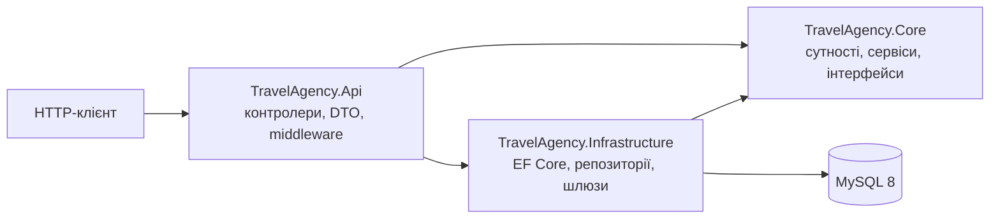
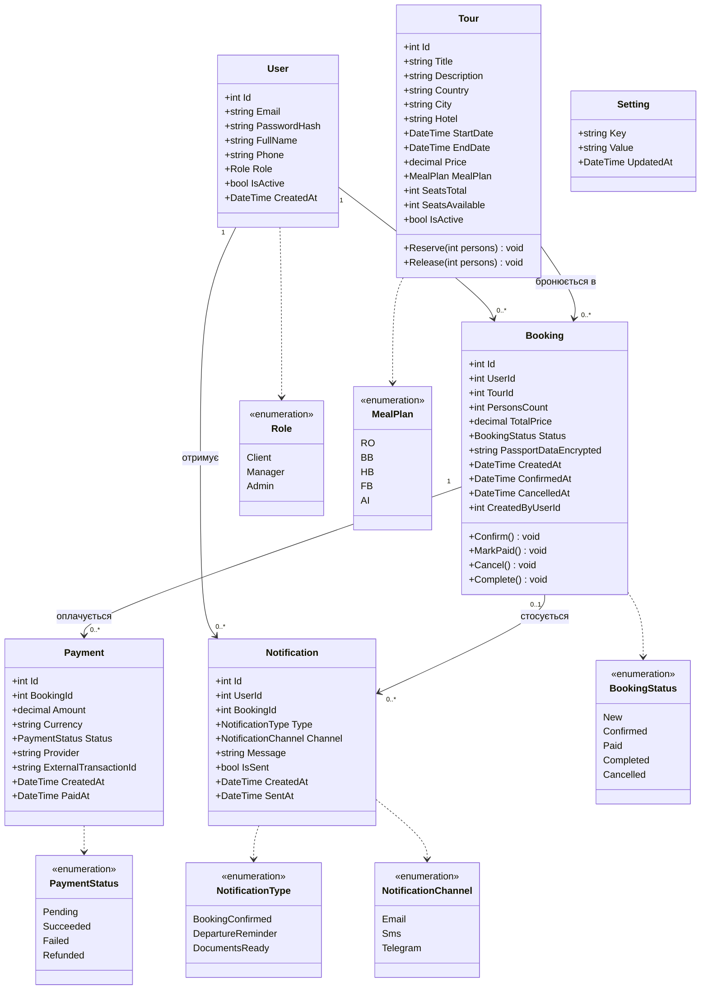
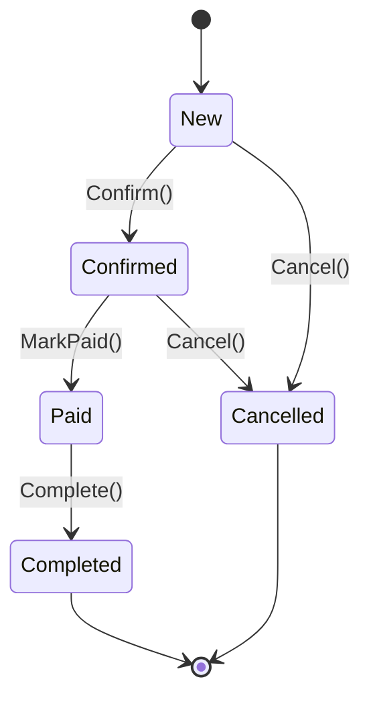
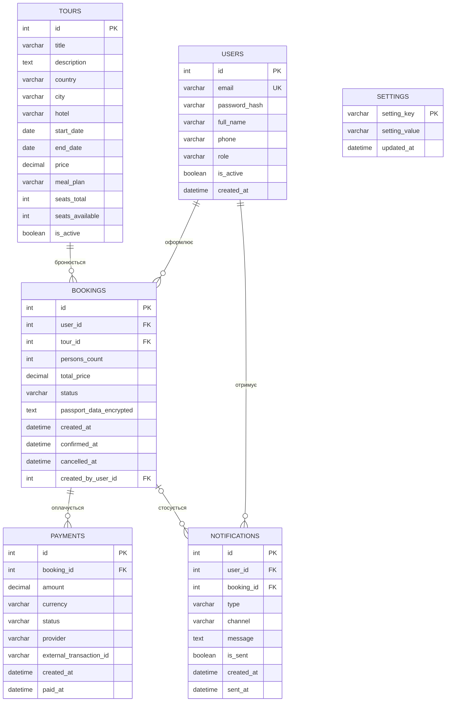

# 02. Проєктування моделей реалізації

Друга частина ЛР3. На основі аналізу вимог (`01-requirements-analysis.md`) подано:
діаграми класів зі зв'язками, опис атрибутів і методів, ER-діаграму бази даних MySQL,
діаграму станів бронювання та специфікацію REST API.

Діаграми записані мовою Mermaid і відображаються безпосередньо на GitHub.

## 1. Архітектура

Рішення має три проєкти та шари `Controller → Service → Repository`:

`Core` не залежить від інших проєктів: усі зовнішні залежності (БД, шифрування, платіжний шлюз,
сповіщення) подані інтерфейсами, реалізації яких лежать в `Infrastructure`.
Це спрощує тестування (у ЛР4 інтерфейси підміняються через Moq).

## 2. Діаграма класів: доменна модель

Поля `ConfirmedAt`, `CancelledAt`, `CreatedByUserId`, `PaidAt`, `BookingId` у `Notification`,
`SentAt` можуть бути порожніми (nullable `DateTime?` / `int?` у коді).

### 2.1. Опис сутностей і атрибутів

**User** (користувач)

| Атрибут | Тип | Обмеження | Опис |
|---|---|---|---|
| Id | int | PK, auto increment | Ідентифікатор |
| Email | string(255) | унікальний, обов'язковий | Логін |
| PasswordHash | string(100) | обов'язковий | Хеш BCrypt |
| FullName | string(200) | обов'язковий | ПІБ |
| Phone | string(30) | | Телефон |
| Role | Role | обов'язковий | Client / Manager / Admin |
| IsActive | bool | за замовчуванням true | Ознака активності |
| CreatedAt | DateTime | | Дата реєстрації |

**Tour** (тур)

| Атрибут | Тип | Обмеження | Опис |
|---|---|---|---|
| Id | int | PK | Ідентифікатор |
| Title | string(200) | обов'язковий | Назва |
| Description | string | | Опис |
| Country | string(100) | індекс | Країна |
| City | string(100) | | Місто/курорт |
| Hotel | string(200) | | Готель |
| StartDate, EndDate | DateTime | індекс на StartDate; EndDate ≥ StartDate | Дати туру |
| Price | decimal(10,2) | > 0, індекс | Ціна за особу |
| MealPlan | MealPlan | | Тип харчування |
| SeatsTotal | int | ≥ 0 | Усього місць |
| SeatsAvailable | int | 0…SeatsTotal | Вільні місця |
| IsActive | bool | | Чи показується в каталозі |

**Booking** (бронювання)

| Атрибут | Тип | Обмеження | Опис |
|---|---|---|---|
| Id | int | PK | Ідентифікатор |
| UserId | int | FK → User | Клієнт |
| TourId | int | FK → Tour | Тур |
| PersonsCount | int | ≥ 1 | Кількість осіб |
| TotalPrice | decimal(10,2) | | Price × PersonsCount на момент бронювання |
| Status | BookingStatus | | Статус заявки |
| PassportDataEncrypted | string | обов'язковий | Паспортні дані, зашифровані AES-256-GCM |
| CreatedAt | DateTime | | Дата створення |
| ConfirmedAt, CancelledAt | DateTime? | | Дати змін статусу |
| CreatedByUserId | int? | FK → User | Менеджер, що створив бронювання (UC-12) |

**Payment** (оплата)

| Атрибут | Тип | Обмеження | Опис |
|---|---|---|---|
| Id | int | PK | Ідентифікатор |
| BookingId | int | FK → Booking | Бронювання |
| Amount | decimal(10,2) | > 0 | Сума |
| Currency | string(3) | | Валюта (UAH) |
| Status | PaymentStatus | | Статус платежу |
| Provider | string(50) | | Платіжний шлюз |
| ExternalTransactionId | string(100) | | Ідентифікатор у шлюзі |
| CreatedAt, PaidAt | DateTime / DateTime? | | Дати |

**Notification** (сповіщення), **Setting** (налаштування) мають поля, наведені на діаграмі.
`Setting.Key` є первинним ключем.

### 2.2. Зв'язки між сутностями

| Зв'язок | Кратність | Пояснення |
|---|---|---|
| User — Booking | 1 : 0..* | Клієнт має багато бронювань |
| Tour — Booking | 1 : 0..* | На тур може бути багато бронювань |
| Booking — Payment | 1 : 0..* | Можливі кілька спроб оплати |
| User — Notification | 1 : 0..* | Користувач отримує сповіщення |
| Booking — Notification | 0..1 : 0..* | Сповіщення може стосуватися бронювання |

### 2.3. Методи сутностей (інваріанти предметної області)

| Метод | Опис | Правило |
|---|---|---|
| `Tour.Reserve(persons)` | Зменшує `SeatsAvailable` | Помилка, якщо `persons` < 1 або більше вільних місць |
| `Tour.Release(persons)` | Повертає місця | Не перевищує `SeatsTotal` |
| `Booking.Confirm()` | `New → Confirmed` | Бізнес-правило 2, 4 |
| `Booking.MarkPaid()` | `Confirmed → Paid` | Бізнес-правило 5 |
| `Booking.Cancel()` | `New / Confirmed → Cancelled` | Бізнес-правило 2, 3 |
| `Booking.Complete()` | `Paid → Completed` | Після завершення туру |

Недопустимий перехід викликає `InvalidOperationException`, яку глобальний обробник перетворює на HTTP 409.

## 3. Діаграма станів бронювання

## 4. Діаграма класів: сервіси та інтерфейси (TravelAgency.Core)

```mermaid
classDiagram
    class AuthService {
        +Register(RegisterRequest request) User
        +Login(LoginRequest request) AuthResult
    }
    class TourService {
        +GetAll(int page, int pageSize) PagedResult
        +GetById(int id) Tour
        +Search(TourSearchCriteria criteria) PagedResult
        +Create(CreateTourRequest request) Tour
        +Update(int id, UpdateTourRequest request) Tour
        +Delete(int id) void
    }
    class BookingService {
        +Create(int userId, CreateBookingRequest request, int createdBy) Booking
        +GetMy(int userId) List~Booking~
        +Cancel(int bookingId, int actorId, Role actorRole) void
        +Confirm(int bookingId) Booking
    }
    class AvailabilityChecker {
        +IsAvailable(Tour tour, int persons, DateTime now) bool
    }
    class PaymentService {
        +Pay(int bookingId, int userId) Payment
        +GetByBooking(int bookingId) List~Payment~
        +Verify(int paymentId) Payment
    }
    class CustomerService {
        +GetCustomers(int page, int pageSize, string search) PagedResult
        +GetCustomer(int id) User
    }
    class UserAdminService {
        +GetUsers(int page, int pageSize) PagedResult
        +ChangeRole(int userId, Role role) void
        +SetActive(int userId, bool isActive) void
    }
    class ReportService {
        +GetSalesReport(DateTime from, DateTime to) SalesReport
    }
    class SettingsService {
        +GetAll() List~Setting~
        +Set(string key, string value) void
    }
    class NotificationService {
        +SendBookingStatus(Booking booking) void
        +SendDepartureReminders(int daysBefore) void
    }

    class IUserRepository {
        <<interface>>
        +GetById(int id) User
        +GetByEmail(string email) User
        +Add(User user) void
        +List(int page, int pageSize, string search) PagedResult
    }
    class ITourRepository {
        <<interface>>
        +GetById(int id) Tour
        +Search(TourSearchCriteria criteria) PagedResult
        +Add(Tour tour) void
        +Remove(Tour tour) void
    }
    class IBookingRepository {
        <<interface>>
        +GetById(int id) Booking
        +GetByUser(int userId) List~Booking~
        +Add(Booking booking) void
    }
    class IPaymentRepository {
        <<interface>>
        +Add(Payment payment) void
        +GetByBooking(int bookingId) List~Payment~
    }
    class INotificationRepository {
        <<interface>>
        +Add(Notification notification) void
    }
    class ISettingRepository {
        <<interface>>
        +GetAll() List~Setting~
        +Upsert(Setting setting) void
    }
    class IUnitOfWork {
        <<interface>>
        +BeginTransaction() void
        +Commit() void
        +Rollback() void
        +SaveChanges() int
    }
    class IPasswordHasher {
        <<interface>>
        +Hash(string password) string
        +Verify(string password, string hash) bool
    }
    class ITokenService {
        <<interface>>
        +CreateToken(User user) string
    }
    class IEncryptionService {
        <<interface>>
        +Encrypt(string plainText) string
        +Decrypt(string cipherText) string
    }
    class IPaymentGateway {
        <<interface>>
        +Charge(PaymentRequest request) PaymentResult
        +GetStatus(string externalId) PaymentStatus
    }
    class INotifier {
        <<interface>>
        +Send(NotificationChannel channel, string recipient, string message) void
    }

    AuthService --> IUserRepository
    AuthService --> IPasswordHasher
    AuthService --> ITokenService
    TourService --> ITourRepository
    BookingService --> IBookingRepository
    BookingService --> ITourRepository
    BookingService --> AvailabilityChecker
    BookingService --> IEncryptionService
    BookingService --> IUnitOfWork
    BookingService --> NotificationService
    PaymentService --> IPaymentRepository
    PaymentService --> IBookingRepository
    PaymentService --> IPaymentGateway
    PaymentService --> IUnitOfWork
    CustomerService --> IUserRepository
    UserAdminService --> IUserRepository
    ReportService --> IBookingRepository
    ReportService --> IPaymentRepository
    SettingsService --> ISettingRepository
    NotificationService --> INotificationRepository
    NotificationService --> IBookingRepository
    NotificationService --> INotifier
```

Усі методи сервісів асинхронні (повертають `Task` або `Task<T>`; у діаграмі для стислості тип `Task` опущено).

## 5. Діаграма класів: реалізації та контролери

```mermaid
classDiagram
    class AuthController
    class ToursController
    class BookingsController
    class PaymentsController
    class CustomersController
    class AdminController

    class AuthService
    class TourService
    class BookingService
    class PaymentService
    class CustomerService
    class UserAdminService
    class ReportService
    class SettingsService

    class IUserRepository { <<interface>> }
    class ITourRepository { <<interface>> }
    class IBookingRepository { <<interface>> }
    class IPaymentRepository { <<interface>> }
    class IPaymentGateway { <<interface>> }
    class INotifier { <<interface>> }
    class IPasswordHasher { <<interface>> }
    class ITokenService { <<interface>> }
    class IEncryptionService { <<interface>> }
    class IUnitOfWork { <<interface>> }

    class AppDbContext
    class EfUserRepository
    class EfTourRepository
    class EfBookingRepository
    class EfPaymentRepository
    class FakePaymentGateway
    class ConsoleNotifier
    class BCryptPasswordHasher
    class JwtTokenService
    class AesEncryptionService
    class EfUnitOfWork

    AuthController --> AuthService
    ToursController --> TourService
    BookingsController --> BookingService
    PaymentsController --> PaymentService
    CustomersController --> CustomerService
    AdminController --> UserAdminService
    AdminController --> ReportService
    AdminController --> SettingsService

    EfUserRepository ..|> IUserRepository
    EfTourRepository ..|> ITourRepository
    EfBookingRepository ..|> IBookingRepository
    EfPaymentRepository ..|> IPaymentRepository
    FakePaymentGateway ..|> IPaymentGateway
    ConsoleNotifier ..|> INotifier
    BCryptPasswordHasher ..|> IPasswordHasher
    JwtTokenService ..|> ITokenService
    AesEncryptionService ..|> IEncryptionService
    EfUnitOfWork ..|> IUnitOfWork

    EfUserRepository --> AppDbContext
    EfTourRepository --> AppDbContext
    EfBookingRepository --> AppDbContext
    EfPaymentRepository --> AppDbContext
    EfUnitOfWork --> AppDbContext
```

`FakePaymentGateway` та `ConsoleNotifier` — заглушки, що замінюють LiqPay/Stripe та SMS/Email (див. межі реалізації).
Заміна реалізації не змінює сервісів, оскільки вони залежать лише від інтерфейсів.

## 6. ER-діаграма бази даних MySQL

Індекси: `users(email)` унікальний; `tours(country)`, `tours(start_date)`, `tours(price)`;
`bookings(user_id)`, `bookings(tour_id)`, `bookings(status)`; `payments(booking_id)`.
Зовнішні ключі підтримуються рушієм InnoDB. Перелічення (`role`, `status`, `meal_plan` тощо)
зберігаються рядками, щоб дані були читабельними у БД.

## 7. Специфікація REST API

| Метод і URL | Прецедент | Доступ |
|---|---|---|
| `POST /api/auth/register` | UC-01 | Усі |
| `POST /api/auth/login` | UC-02 | Усі |
| `GET /api/tours` | UC-03 | Усі |
| `GET /api/tours/{id}` | UC-04 | Усі |
| `GET /api/tours/search?country&from&to&hotel&minPrice&maxPrice&mealPlan` | UC-05 | Усі |
| `POST /api/tours`, `PUT /api/tours/{id}`, `DELETE /api/tours/{id}` | UC-15 | Manager, Admin |
| `POST /api/bookings` | UC-06 (клієнт), UC-12 (менеджер вказує клієнта) | Client, Manager, Admin |
| `GET /api/bookings/my` | UC-08 | Client |
| `POST /api/bookings/{id}/cancel` | UC-09 | Client (своє), Manager, Admin |
| `POST /api/bookings/{id}/confirm` | UC-13 | Manager, Admin |
| `POST /api/payments` | UC-10 | Client |
| `GET /api/payments/booking/{bookingId}` | UC-14 | Manager, Admin |
| `GET /api/customers`, `GET /api/customers/{id}` | UC-11 | Manager, Admin |
| `GET /api/admin/users`, `PUT /api/admin/users/{id}/role`, `PUT /api/admin/users/{id}/status` | UC-16 | Admin |
| `GET /api/admin/reports/sales?from&to` | UC-17 | Admin |
| `GET /api/admin/settings`, `PUT /api/admin/settings/{key}` | UC-18 | Admin |
| `GET /health` | NFR «Надійність» | Усі |

Перевірка доступності туру (UC-07) не має власної кінцевої точки: вона виконується всередині `BookingService.Create`
через `AvailabilityChecker` (зв'язок `<<include>>` з Use Case діаграми).

## 8. Проєктні рішення

| Рішення | Обґрунтування |
|---|---|
| Інваріанти в сутностях (`Booking.Confirm()` тощо) | Недопустимий стан неможливо створити в обхід сервісу |
| Інтерфейси для зовнішніх залежностей | Тестування без БД і зовнішніх сервісів; підміна заглушок реальними шлюзами |
| `IUnitOfWork` у бронюванні й оплаті | Місця туру та статус бронювання змінюються в одній транзакції (бізнес-правило 6) |
| Сума оплати береться з `Booking.TotalPrice` | Клієнт не може підмінити суму (бізнес-правило 5) |
| Шаблони проектування (ЛР5) | Кандидати: Repository (вже використано), Strategy/Adapter для `IPaymentGateway`, Factory для сповіщень, State для статусів бронювання |

## 9. Наступний крок

Створити в репозиторії проєкти рішення (`Core`, `Infrastructure`, `Api`, `Tests`) і підключити пакети.
